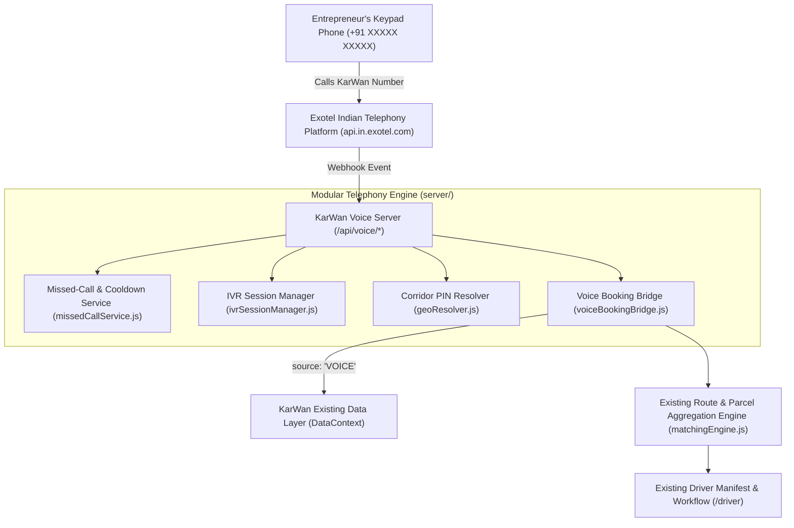

# KarWan — Complete Voice Calling & Missed-Call Telephony Integration Guide

> **Purpose**: Enables rural entrepreneurs with ordinary keypad mobile phones (non-smartphones, no internet access) to book shared transportation, check consignment status, or speak to a regional hub operator using Exotel DTMF IVR and automated missed-call callbacks.

---

## 1. System Architecture



---

## 2. Telephony Features & IVR Flow

### A. Missed-Call Callback System
1. Entrepreneur dials the official KarWan Exotel number and disconnects (missed call).
2. The server detects the call via `POST /api/voice/missed-call`.
3. Cooldown check: Prevents infinite callback loops and duplicate spam (`VOICE_CALLBACK_COOLDOWN_MINUTES = 10`, max 5 attempts/day).
4. If eligible, an automated outbound callback connects the entrepreneur directly into the automated voice menu.

### B. DTMF Keypad IVR Workflow
* **Language Selection**:
  * Press `1` $\rightarrow$ Hindi (हिंदी)
  * Press `2` $\rightarrow$ English
  *(Architecture extensible to Marathi)*
* **Main Menu**:
  * Press `1` $\rightarrow$ New transportation booking
  * Press `2` $\rightarrow$ Check existing booking status
  * Press `3` or `0` $\rightarrow$ Connect to regional hub operator
  * Press `9` $\rightarrow$ Repeat current menu
* **New Booking Flow**:
  1. **Pickup PIN**: Enter 6 digits + `#` (e.g. `413102#` $\rightarrow$ Baramati).
  2. **Destination PIN**: Enter 6 digits + `#` (e.g. `415523#` $\rightarrow$ Phaltan).
  3. **Parcel Size**: `1` (Small crate ~15kg), `2` (Medium sack ~35kg), `3` (Bulk carton ~75kg).
  4. **Quantity**: Enter quantity + `#` (e.g. `2#`).
  5. **Pickup Date**: `1` for Today, `2` for Tomorrow, `3` for Day After.
  6. **Pickup Window**: `1` (6-10 AM), `2` (8-12 PM), `3` (12-4 PM), `4` (4-8 PM).
  7. **Dynamic Readback**: Spoken review of all details.
  8. **Confirmation**: `1` to Confirm, `2` to Modify, `3` to Cancel.
* **Seamless Aggregation Engine Trigger**:
  * On Key `1`, booking is committed with `source: "VOICE"`.
  * It immediately passes into KarWan's existing `matchingEngine.js` for shared corridor batching alongside web consignments.

---

## 3. Environment Configuration

Add the following variables to your `.env` or deployment environment:

```env
# Telephony Provider Selection: "mock" (default, free dev) or "exotel" (live production)
VOICE_PROVIDER=mock

# Exotel Account Credentials (from https://my.exotel.com/)
EXOTEL_API_KEY=your_exotel_api_key
EXOTEL_API_TOKEN=your_exotel_api_token
EXOTEL_ACCOUNT_SID=your_exotel_subdomain_sid
EXOTEL_PHONE_NUMBER=0XXXXXXXXX
EXOTEL_BASE_URL=https://api.in.exotel.com
EXOTEL_FLOW_URL=https://my.exotel.com/v1/Accounts/your_sid/Apps/your_applet_id

# Webhook & Operational Settings
VOICE_WEBHOOK_BASE_URL=https://your-domain.com
VOICE_DEFAULT_LANGUAGE=hi
VOICE_CALLBACK_ENABLED=true
VOICE_CALLBACK_COOLDOWN_MINUTES=10
VOICE_SERVER_PORT=4000
```

---

## 4. Exotel Dashboard Configuration Guide

1. **Log in to Exotel**: Visit [https://my.exotel.com](https://my.exotel.com).
2. **Applet Call Flow**:
   - Go to **App Bazaar** $\rightarrow$ **Create Flow**.
   - Add a **Passthru Applet** pointing to:
     ```
     POST https://your-domain.com/api/voice/incoming
     ```
   - For subsequent DTMF digits, route the gather action to:
     ```
     POST https://your-domain.com/api/voice/ivr/input
     ```
   - On call completion / hangup, set status callback to:
     ```
     POST https://your-domain.com/api/voice/status
     ```
3. **Assign Phone Number**:
   - In **Numbers**, link your dedicated virtual number to the created Flow.

---

## 5. Development Mock Mode & Testing

The system includes a zero-cost local development mock mode. To run the automated verification test suite:

```bash
node tests/voiceTelephony.test.js
```

**Test Coverage**:
- Exotel mock safety (zero external paid calls)
- DTMF state progression
- PIN code to corridor hub resolution
- Readback script generation in Hindi & English
- Booking injection with `source: 'VOICE'`
- Route matching engine execution
- Missed call cooldown & rate limiting
- Operator assistance queuing

To start the standalone voice HTTP server locally:
```bash
node -e "import('./server/voiceServer.js').then(m => m.startVoiceServer(4000))"
```

---

## 6. Files Added & Modified

* **New Isolated Server Modules**:
  - [`server/voiceServer.js`](file:///server/voiceServer.js) — REST webhook listener for Exotel.
  - [`server/services/ivrPrompts.js`](file:///server/services/ivrPrompts.js) — Multilingual prompts & status phrases.
  - [`server/services/geoResolver.js`](file:///server/services/geoResolver.js) — Rural PIN-to-hub mapping.
  - [`server/services/ivrSessionManager.js`](file:///server/services/ivrSessionManager.js) — DTMF state machine.
  - [`server/services/missedCallService.js`](file:///server/services/missedCallService.js) — Cooldown & callback scheduling.
  - [`server/services/exotelService.js`](file:///server/services/exotelService.js) — Exotel REST API integration.
  - [`server/services/voiceBookingBridge.js`](file:///server/services/voiceBookingBridge.js) — Connector to existing KarWan booking & aggregation engine.
* **Test Suite**:
  - [`tests/voiceTelephony.test.js`](file:///tests/voiceTelephony.test.js) — Automated integration tests (26 passing tests).
* **Existing Project Integrity**:
  - **Zero frontend alterations**: Existing pages, styles, and dashboard components remain completely unchanged and compile cleanly (`npm run build` passing 100%).

