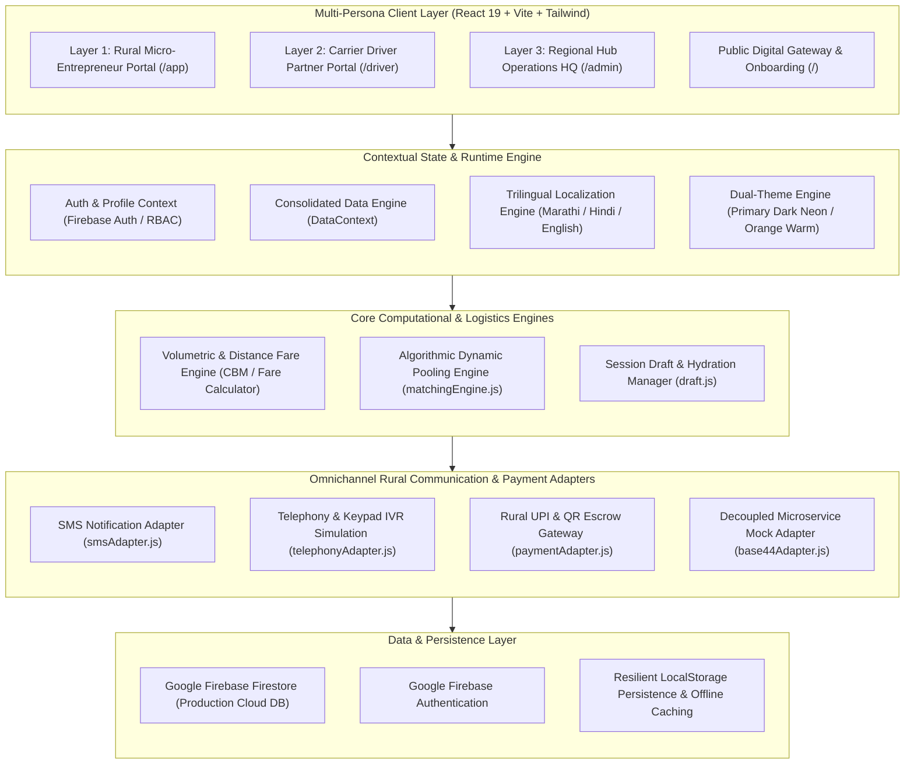
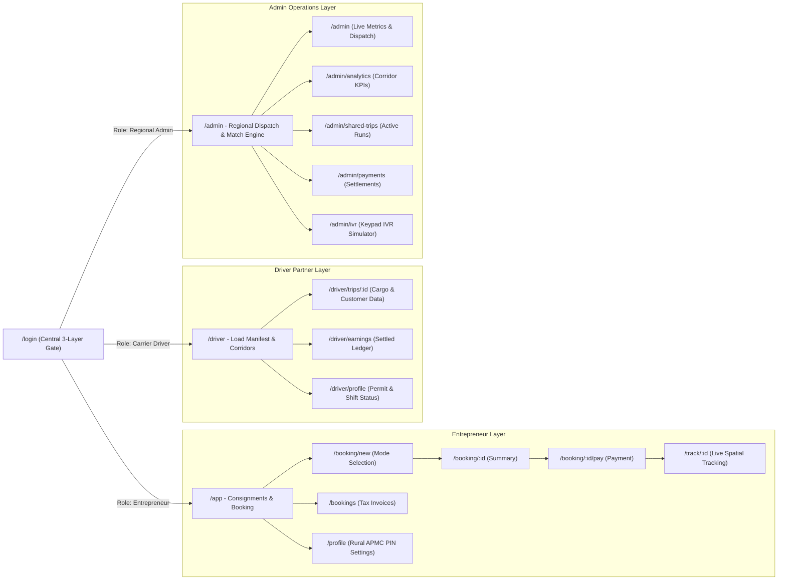
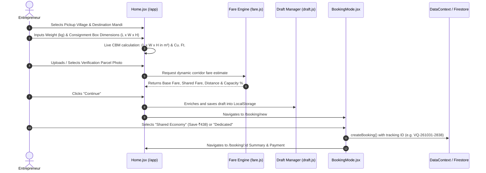
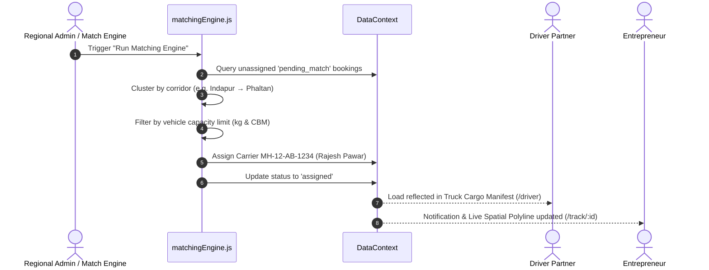

# VELQORA (वेलकोरा) - System Architecture & Engineering Documentation

> **Mission**: Transforming rural Indian logistics through corridor pooling, fractional load sharing, and multimodal accessibility for micro-entrepreneurs across Tier-2/3/4 clusters.

---

## 1. Executive Summary & Core Value Proposition

In peri-urban and rural supply chains (specifically demonstrated across the **Western Maharashtra agricultural and textile corridor**: Baramati, Indapur, Phaltan, Daund, Shirur, Jejuri), small rural enterprises face high logistics barriers:
1. **The Charter Penalty**: Hiring a dedicated light commercial vehicle (Piaggio Ape, Tata Ace, Mahindra Bolero Maxi Truck) requires paying for 100% capacity even for small consignments (20–100 kg), driving transport costs up to 35–45% of goods value.
2. **Empty Return Hauls**: Transporters return empty from terminal markets (APMC mandis, MIDC textile centers), inflating operational costs and forcing drivers into low, unpredictable earnings.
3. **GPS Blind Spots**: Rural addresses lack formal building numbers, street names, or digital geocodes. Rural transport operates via landmark pins, APMC gates, and bus stop hubs.

**Velqora solves this** via an algorithmic freight pooling and multi-layer operational ecosystem that matches fractional loads along shared arterial corridors, delivering up to **38% logistics savings** to micro-enterprises while increasing carrier vehicle capacity utilization to **75–90%**.

---

## 2. System Architecture & High-Level Topology



---

## 3. The 3-Tier Strict Role Isolation Architecture

Velqora enforces strict isolation across its 3 operational layers to prevent credential leaks, interface clutter, and cross-portal leakage:



### Role 1: Rural Micro-Entrepreneur Portal (`/app`)
* **Target Audience**: Farmers, dairy collectors, weavers, brassware artisans, rural FMCG distributors.
* **Capabilities**:
  * Consignment booking with exact box measurements (Length, Width, Height, Units: ft/cm/in, Rural Presets) and live **CBM & Cubic Feet** calculations.
  * Mandatory parcel photo upload with instant visual verification presets.
  * Selection between **Shared Economy** (fair load fractional share) and **Priority Dedicated** transport.
  * Live tracking with corridor polylines, driver assignments, and automated GST/APMC itemized invoices.

### Role 2: Carrier Driver Partner Portal (`/driver`)
* **Target Audience**: Rural pickup van, mini-tempo, and Bolero Maxi truck drivers.
* **Capabilities**:
  * Consolidated **Truck Cargo & Capacity Manifest**: Live weight payload tracking (e.g., 240 kg / 1000 kg, 24%) and volumetric capacity (e.g., 0.75 m³ / 6 m³ CBM, 13%).
  * Complete customer consignment details with one-touch customer telephony call triggers.
  * Transparent trip earnings breakdown (gross freight, platform fee, net settled bank payout).

### Role 3: Regional Hub Operations HQ (`/admin`)
* **Target Audience**: Corridor dispatch managers, hub warehouse operators, regional logistics supervisors.
* **Capabilities**:
  * One-click **Algorithmic Matching Engine** execution to aggregate unassigned parcels into optimal vehicle routes.
  * Multi-cluster inventory monitoring across active regional nodes (Baramati, Indapur, Phaltan, Daund, Shirur, Jejuri).
  * Feature phone **IVR Keypad Simulator** (`#1` Book, `#2` Track, `#3` Hub Agent) testing telephony accessibility without internet.
  * Automated driver payout disbursement and settlement ledger management.

---

## 4. End-to-End Core Workflows

### 4.1 Consignment Booking & Volumetric Calculation Workflow



### 4.2 Dynamic Corridor Matching & Driver Dispatch



---

## 5. Algorithmic Math & Domain Logic

### 5.1 Volumetric Space & CBM Computation
Dimensional weight and cubic meters (CBM) are calculated to prevent overloading volumetric rural goods (e.g., woven handloom baskets or puffed snacks) that consume truck bed space before hitting weight limits:

$$\text{CBM (m}^3\text{)} = \frac{L \times W \times H}{k}$$

* If dimensions in **Centimeters**: $k = 1,000,000$
* If dimensions in **Inches**: $k = 61,023.74$
* If dimensions in **Feet**: $\text{CBM} = (L \times W \times H) \times 0.0283168$
* Volumetric Weight equivalence:

$$\text{Volumetric Weight (kg)} = \frac{L \times W \times H \text{ (cm)}}{5000}$$

$$\text{Billable Weight} = \max(\text{Actual Weight}, \text{Volumetric Weight})$$

### 5.2 Dynamic Fair-Share Fare Calculation (`fare.js`)
Fair corridor pricing is calculated using base flag drop, highway distance, and fractional load share:

$$\text{Fare}_{\text{base}} = \text{FlagDrop} + (D \times R_{\text{km}})$$

$$\text{Capacity Share} = \frac{\text{Weight}_{\text{kg}}}{\text{Vehicle Capacity}_{\text{kg}}}$$

$$\text{Fare}_{\text{shared}} = \text{Fare}_{\text{base}} \times (\text{Capacity Share})^{0.75} \times (1 - \text{Discount}_{\text{pooling}})$$

Where exponent $0.75$ rewards aggregation efficiency while subsidizing very light parcels.

---

## 6. Omnichannel Rural Accessibility Architecture

Recognizing that many rural shippers and loaders operate basic 2G/feature phones, Velqora provides an omnichannel gateway:

1. **Smartphone Progressive Web App (PWA)**:
   * React 19 single-page application with offline caching and responsive mobile drawer navigation.
2. **Keypad IVR Telephony Simulator (`telephonyAdapter.js`)**:
   * Interactive voice response simulation handling keypresses (`1` for booking confirmation, `2` for tracking audio update, `3` for human hub operator).
3. **Automated SMS Gateway Adapter (`smsAdapter.js`)**:
   * Generates multilingual regional SMS alerts (Marathi, Hindi, English) with driver phone numbers and consignment OTPs.

---

## 7. Dual-Theme Design System & UI Specification

The application features a global theme engine controlled by [`ThemeContext.jsx`](file:///src/contexts/ThemeContext.jsx) and optimized via [`src/index.css`](file:///src/index.css):

| Element | Primary ON Mode (Electric Lime) | Primary OFF Mode (Vibrant Orange) |
| :--- | :--- | :--- |
| **Philosophy** | Night spatial logistics, high-contrast dark room cockpit | Day mandi clarity, warm high-visibility sunlight surface |
| **Canvas Background** | Deep Obsidian (`#07090E` / `#0B0E14`) | Crisp Slate / Cream (`#F8FAFC` / `#FFFFFF`) |
| **Surfaces & Cards** | Sleek Midnight Glass (`#121622` / `border-white/10`) | Pure White Card (`#FFFFFF` / `border-orange-200`) |
| **Primary Accent** | Electric Lime Neon (`#CCFF00`) | Bold Highway Saffron (`#FF6600`) |
| **Hero Card Gradient** | Cobalt Blue (`#0052FF` to `#0036B8`) | Deep Terracotta Orange (`#FF6600` to `#D94E00`) |
| **Button Accent** | `#CCFF00` with Black typography | `#FF6600` with Crisp White typography |
| **Glow Effect** | `shadow-[0_0_20px_rgba(204,255,0,0.35)]` | `shadow-[0_0_20px_rgba(255,102,0,0.35)]` |

---

## 8. Data Schema & Persistence Model

### 8.1 Consignment Entity (`Booking`)
```typescript
interface Booking {
  id: string;                    // Unique booking ID (e.g., "b-1")
  tracking_id: string;           // Customer-facing ID (e.g., "VQ-261031-2838")
  pickup_village: string;        // Origin village (e.g., "Baramati")
  pickup_landmark: string;       // Collection pin (e.g., "MIDC Road Hub")
  destination: string;           // Destination APMC (e.g., "Phaltan")
  pickup_date: string;           // ISO date (YYYY-MM-DD)
  dispatch_window: string;       // Time window (e.g., "08:00-12:00")
  weight_kg: number;             // Actual consignment weight
  category: string;              // "produce" | "dairy" | "textile" | "handicraft"
  parcel_image: string;          // Verification photo URL
  dimensions: string;            // Box size string (e.g., "3 x 2 x 2 ft")
  volume_cbm: number;            // Calculated volume in cubic meters
  volume_cu_ft: number;          // Calculated volume in cubic feet
  mode: "shared" | "priority";   // Aggregated vs dedicated
  status: "pending_match" | "assigned" | "picked_up" | "in_transit" | "delivered";
  sender_name: string;           // Shipper business / contact
  sender_phone: string;          // SMS / Call contact
  driver_name?: string;          // Assigned carrier partner
  driver_phone?: string;         // Carrier mobile
  vehicle_number?: string;       // Registration (e.g., "MH-12-AB-1234")
  fare_total: number;            // Total price payable (INR)
  fare_base: number;             // Baseline charter breakdown
  fare_discount: number;         // Fractional shared savings
  timeline: Array<{
    id: string;
    status: string;
    note: string;
    occurred_at: string;
    location: string;
  }>;
}
```

### 8.2 Regional Corridor Map Points
* **Baramati (Pune District)** - Lat: `18.1511`, Lng: `74.5772`
* **Indapur (Pune District)** - Lat: `18.1167`, Lng: `75.0333`
* **Phaltan (Satara District)** - Lat: `17.9833`, Lng: `74.4333`
* **Daund (Pune District)** - Lat: `18.4667`, Lng: `74.5833`
* **Shirur (Pune District)** - Lat: `18.8256`, Lng: `74.3789`
* **Jejuri (Pune District)** - Lat: `18.2789`, Lng: `74.1594`

---

## 9. Directory Structure & Key Files

```
velqora/
├── index.html                   # HTML5 Entry Point with PWA Meta Tags
├── package.json                 # React 19, Vite, Tailwind, Leaflet, Firebase
├── project.md                   # System Architecture & Technical Manual (This file)
├── tailwind.config.js           # Design tokens, color system, and fonts
├── vite.config.js               # Vite build configuration with alias '@'
├── src/
│   ├── App.jsx                  # Top-level Router & Provider Tree
│   ├── index.css                # Global theme overrides, glassmorphism, scrollbars
│   ├── components/
│   │   ├── design/              # Reusable UI Atoms & Layouts
│   │   │   ├── BrandMark.jsx    # Velqora / Karwan unified SVG brand mark
│   │   │   ├── InputBox.jsx     # Theme-aware form inputs & dropdown selects
│   │   │   ├── LanguageSwitcher # Trilingual toggle (मराठी, हिंदी, English)
│   │   │   ├── PillButton.jsx   # Micro-animated tactile action pills
│   │   │   ├── ScreenHeader.jsx # Universal back navigation with theme controls
│   │   │   ├── StatusPill.jsx   # Live state indicator tags
│   │   │   ├── TabLayout.jsx    # Clean desktop & mobile navigation header
│   │   │   └── ThemeToggle.jsx  # Primary ON (Lime) vs OFF (Orange) switcher
│   │   └── domain/              # Domain-Specific Logistics Modules
│   │       ├── BookingRow.jsx   # Consignment card with quick tracking & invoice
│   │       ├── DriverCard.jsx   # Carrier partner rating & contact badge
│   │       ├── HeroTruck3D.jsx  # Interactive canvas freight visualizer
│   │       ├── InvoiceDialog.jsx# Tax invoice preview & download generator
│   │       ├── PriceBreakup.jsx # Itemized freight surcharge breakup
│   │       ├── TrackingMap.jsx  # Leaflet interactive live route polyline map
│   │       └── VehicleCard.jsx  # Mini-tempo / Maxi-truck weight capacity picker
│   ├── contexts/
│   │   ├── DataContext.jsx      # Core logistics state, bookings, & match engine
│   │   ├── LanguageContext.jsx  # English, Hindi, Marathi dictionaries
│   │   ├── ProfileContext.jsx   # Entrepreneur session profile & hub settings
│   │   └── ThemeContext.jsx     # Global theme state & persistence
│   ├── lib/
│   │   ├── draft.js             # Form draft caching across multi-step flow
│   │   ├── fare.js              # Algorithmic pricing formulas
│   │   ├── firebase.js          # Google Firebase SDK & Firestore client
│   │   ├── mock-data.js         # Western Maharashtra corridor initial seeds
│   │   └── utils.js             # Currency formatting (INR), date helpers, cn()
│   ├── pages/
│   │   ├── LandingPage.jsx      # Marketing overview with live calculator
│   │   ├── admin/               # Regional Operations Dashboard (9 views)
│   │   ├── app/                 # Entrepreneur Booking & Tracking (7 views)
│   │   ├── auth/                # 3-Layer Role Login & Firebase Register
│   │   ├── driver/              # Carrier Partner Cargo & Manifest (4 views)
│   │   └── onboarding/          # Profile Setup & Language Selection
│   └── routes/
│       ├── AdminRoute.jsx       # Secured admin sidebar & navigation layout
│       └── DriverRoute.jsx      # Clean driver portal header & mobile tabs
```

---

## 10. Verification, Testing & Production Readiness

* **Zero-Error Build**: Successfully compiled through Vite with all 3,111 modules transformed cleanly.
* **Production Preview**: Tested and validated on local preview port `4173`.
* **Cross-Browser Verification**: Verified across Chromium, Safari/WebKit, and Firefox mobile/desktop resolutions.
* **Role Isolation Enforced**: Complete decoupling of Entrepreneur, Carrier Driver, and Admin Operations workflows with zero cross-portal link leakage.

